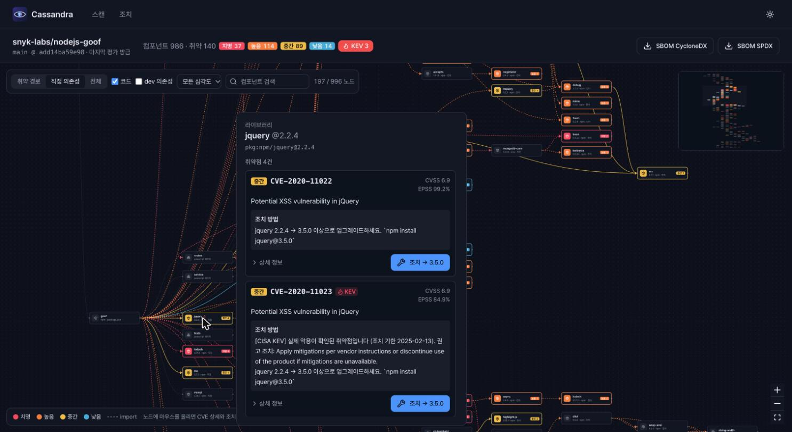
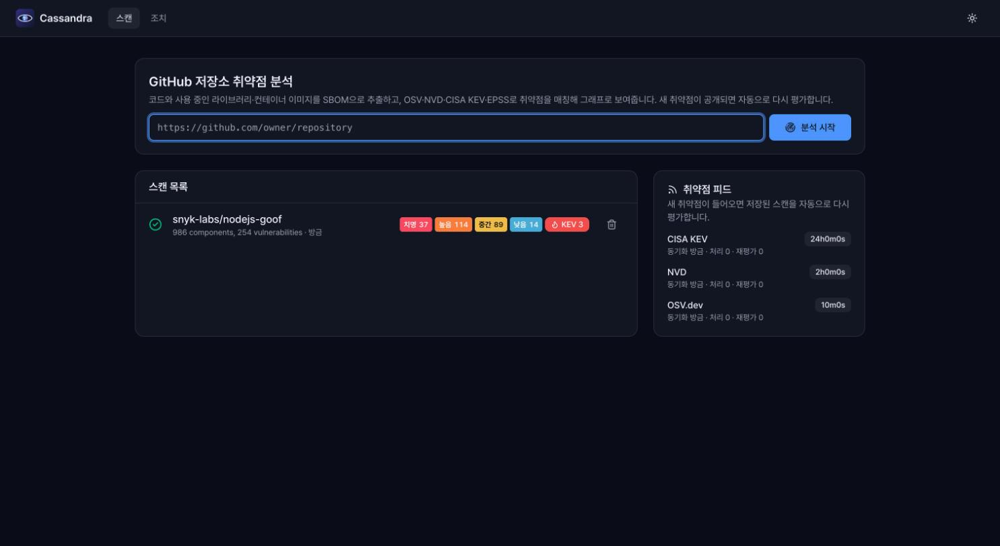
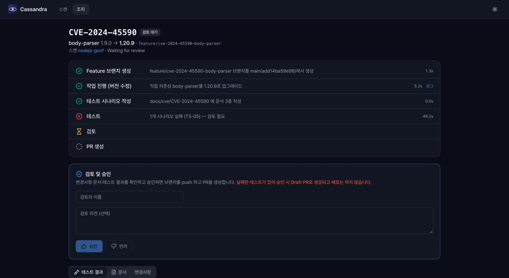
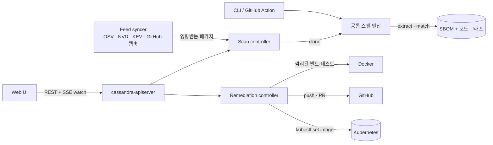

<div align="center">


# Cassandra

**코드와 의존성 속 취약점을 미리 보고, 검토된 PR로 고칩니다.**

[](backend/go.mod)
[](web/package.json)
[](#sbom)
[](#취약점-데이터)
[](LICENSE)

[English](README.md) | 한국어

</div>

<p align="center">
  
</p>

그리스 신화의 카산드라는 재앙이 오기 전에 그것을 내다본 예언자입니다. Cassandra는 같은 일을 소프트웨어에 합니다. GitHub 저장소를 넣으면 SBOM을 만들고, 코드·라이브러리·컨테이너 이미지를 하나의 그래프로 그린 뒤, 알려진 취약점이 있는 컴포넌트를 모두 표시합니다. 나중에 새 권고가 공개되면 이미 스캔한 저장소를 다시 평가합니다. 고칠 때는 노드에 마우스를 올리고 **조치**를 누르면 됩니다. 브랜치 생성, 버전 수정, 테스트 시나리오 작성, 격리 환경 테스트까지 자동으로 진행한 뒤, 사람이 승인해야 PR을 엽니다.

## 기능

- **코드 + 의존성 그래프**: 저장소 → 매니페스트 → 소스 패키지(Go·JS/TS·Python import 분석) → 직접·전이 라이브러리 → 컨테이너 이미지 → 이미지가 실행하는 서버 프로세스(nginx, httpd 등)를 한 그래프로 보여줍니다.
- **취약점 매칭**: 패키지는 OSV, 서버 프로세스는 NVD(CPE)로 매칭합니다. 여기에 **CISA KEV**(실제 악용 여부)와 **FIRST EPSS**(악용 확률)를 더합니다. GHSA·GO·PYSEC ↔ CVE 별칭은 하나의 결과로 합칩니다.
- **지속 재평가**: OSV·NVD·KEV 증분 동기화와 GitHub `security_advisory` 웹훅으로 새 권고를 받습니다. 영향받는 패키지를 가진 저장된 스캔만 다시 매칭하고, 결과는 SSE로 화면에 바로 반영합니다.
- **마우스 오버로 이해하고, 클릭으로 조치**: 노드마다 CVSS, EPSS, KEV 조치 기한, 수정 버전, 생태계별 조치 명령을 보여줍니다.
- **조치 파이프라인**: 브랜치 → 수정 → 테스트 시나리오 → 격리 테스트 → 검토 → 승인 → PR. 서버 이미지는 이미지 빌드 → 실행 테스트 → 배포가 추가됩니다.
- **문서 자동 생성**: 조치마다 `docs/cve/<CVE>/vulnerability-details.md`, `remediation.md`, 결과가 포함된 `test-scenarios.md`를 브랜치에 커밋합니다.
- **SBOM 우선**: 스캔 결과의 원본은 SBOM입니다. CycloneDX 1.6(취약점 포함)과 SPDX 2.3으로 내려받을 수 있습니다.
- **서버 없는 CLI + GitHub Action**: 같은 분석 엔진으로 checkout 디렉터리를 검사합니다. 대상 코드를 실행하지 않고 JSON·Markdown·SBOM·SARIF를 만들며, CI 실패 정책을 명시적으로 적용합니다.
- **Kubernetes 스타일 API**: `/apis/cassandra.io/v1alpha1` 리소스, list + watch, status 서브리소스, 컨트롤러 구조를 kube-apiserver를 따라 만들었습니다.

## 스크린샷

| 스캔 목록과 피드 상태 | 검토 대기 중인 조치 |
|---|---|
|  |  |

## 빠른 시작

**요구 사항:** Go 1.27+, Node.js 24+, git, Docker(빌드·테스트 격리 실행용)

```sh
git clone https://github.com/jinho-yoo-jack/Cassandra.git
cd Cassandra

# PR 생성과 비공개 저장소 스캔에 필요합니다.
export GITHUB_TOKEN=$(gh auth token)

make run   # UI와 API 서버를 빌드해 http://127.0.0.1:8080 에서 함께 서비스
```

http://127.0.0.1:8080 을 열고 `https://github.com/snyk-labs/nodejs-goof` 같은 저장소 주소를 넣어 분석을 시작합니다.

### CLI와 GitHub Action

검사만 필요하면 `backend/go.mod`의 Go 버전으로 CLI를 빌드합니다. 실행에는 Node.js·Docker·git·데이터베이스가 필요하지 않습니다.

```sh
make cli
backend/bin/cassandra scan --path . --output-dir cassandra-results --fail-on high
```

종료 코드: **0** 정책 통과, **1** 차단 대상 취약점, **2** 불완전 검사 또는 운영 오류입니다. 심각도 미상도 활성화된 임계값에서 차단하며, `--fail-on none`으로 검사 오류를 숨길 수는 없습니다. 공개 취약점 API를 조회하지만 대상 저장소의 install/build/test 스크립트는 실행하지 않습니다.

Linux X64/ARM64용 Composite Action은 별도 [cassandra-action](https://github.com/jinho-yoo-jack/cassandra-action) 저장소에서 관리합니다. 이 저장소의 정확한 CLI 릴리스 버전을 다운로드하고 체크섬을 검증해 실행하며, 보고서와 Job Summary를 제공합니다. 엔진을 복제하지 않고 자동 수정·PR 생성·배포도 하지 않습니다. [옵션·workflow 예시·릴리스 방법](docs/usage/cli-and-actions.md)을 참고하세요.

### 개발

```sh
make dev-api   # API 서버 :8080
make dev-web   # Vite 핫 리로드 :5173 (/apis 를 :8080 으로 프록시)
make test      # Go vet/race(CLI 포함) + Node 동작 테스트 + 타입 검사
```

## 동작 방식



1. **스캔**: 스캔 컨트롤러가 저장소를 clone하고 매니페스트 추출기로 인벤토리(SBOM)를 만듭니다. 이어서 소스 import를 분석하고, 모든 컴포넌트를 OSV·NVD와 매칭합니다.
2. **감시**: 피드 동기화가 업스트림 변경을 따라갑니다. 영향받는 패키지를 가진 스캔만 다시 평가하고, 새 취약점이 나오면 `NewFindings` 컨디션을 올립니다.
3. **조치**: 조치 컨트롤러는 단계를 `status.steps`에 기록하는 상태 머신입니다. 서버가 재시작돼도 멈춘 단계부터 이어서 진행합니다.

### 조치 파이프라인

| 종류 | 단계 |
|---|---|
| 라이브러리 | 브랜치 생성 → 수정 → 테스트 시나리오 작성 → 테스트 → **검토** → PR |
| 서버 이미지 | 브랜치 생성 → 이미지 태그 수정 → 테스트 시나리오 작성 → 이미지 빌드 → 실행 테스트 → **검토** → 배포 → PR |

사람이 승인하기 전에는 아무것도 push하지 않습니다. 테스트 시나리오가 실패해도 검토 단계로 넘깁니다. 원인이 프로젝트 자체에 있을 수 있기 때문입니다. 이 상태에서 승인하면 **Draft PR**로 열고 배포는 건너뜁니다.

## 취약점 데이터

| 출처 | 용도 | 동기화 |
|---|---|---|
| [OSV.dev](https://osv.dev) | 패키지 취약점(GHSA, Go, PyPA, RustSec 등) | 스캔마다 `querybatch`, `modified_id.csv` 10분마다 |
| [NVD](https://nvd.nist.gov) | CPE 기반 서버 프로세스(nginx, httpd, tomcat, redis 등) | `lastModified` 구간 2시간마다(rate limit 준수) |
| [CISA KEV](https://www.cisa.gov/known-exploited-vulnerabilities-catalog) | 실제 악용 취약점과 조치 기한 | 매일 |
| [FIRST EPSS](https://www.first.org/epss/) | 악용 예측 점수 | 필요할 때 조회, 하루 캐시 |
| GitHub `security_advisory` 웹훅 | 리뷰된 새 권고의 push 알림 | 실시간(선택) |

이렇게 고른 근거는 [docs/research/vulnerability-feeds.md](docs/research/vulnerability-feeds.md)에 있습니다.

## 지원 생태계

| 생태계 | 매니페스트 | 자동 수정 |
|---|---|---|
| Go | `go.mod`(모듈 프록시로 실제 의존 그래프 구성) | `go get` + `go mod tidy`, stdlib는 `toolchain` |
| npm | `package-lock.json` v1–v3, `pnpm-lock.yaml`, `yarn.lock` | install/add, 전이 의존성은 `overrides`·`pnpm.overrides`·`resolutions` |
| Python | `requirements*.txt`, `uv.lock`, `poetry.lock`, `Pipfile.lock` | requirements 고정, `uv lock --upgrade-package` |
| Maven / Gradle | `pom.xml`, `build.gradle(.kts)`, `gradle.lockfile`, 버전 카탈로그 | 버전 리터럴, `${property}`, `dependencyManagement` |
| Rust | `Cargo.lock` | `cargo update --precise` |
| Ruby / PHP | `Gemfile.lock`, `composer.lock` | — |
| 컨테이너 | `Dockerfile`, Compose, Kubernetes 매니페스트 | `FROM`·`image:` 태그 교체(`-alpine` 같은 접미사 유지), `ARG` 기본값 |

자동 수정이 불가능한 경우에는 "수동 조치 필요" 메시지를 남기고 멈춥니다.

## SBOM

```sh
curl -OJ 'http://127.0.0.1:8080/apis/cassandra.io/v1alpha1/scans/<scan>/sbom?format=cyclonedx'
curl -OJ 'http://127.0.0.1:8080/apis/cassandra.io/v1alpha1/scans/<scan>/sbom?format=spdx'
```

CycloneDX 출력에는 의존성 그래프와 매칭된 취약점(등급, 수정 버전, 조치 가이드)이 함께 들어갑니다.

## API

리소스는 `/apis/cassandra.io/v1alpha1` 아래에 있습니다. `GET /apis/cassandra.io/v1alpha1` 이 discovery 문서를 돌려줍니다.

| 리소스 | 동작 |
|---|---|
| `scans` | create, get, list, watch, delete |
| `scans/{name}/graph`, `scans/{name}/sbom` | get |
| `remediations` | create, get, list, watch, delete |
| `remediations/{name}/approval` | create |
| `remediations/{name}/docs`, `remediations/{name}/diff` | get |
| `vulnerabilities/{id}` | get |
| `feeds` | get, list, watch |

```sh
# 스캔을 시작하고 실시간으로 따라가기
curl -X POST http://127.0.0.1:8080/apis/cassandra.io/v1alpha1/scans \
  -d '{"spec":{"repositoryURL":"https://github.com/owner/repo"}}'
curl -N -H 'Accept: text/event-stream' \
  'http://127.0.0.1:8080/apis/cassandra.io/v1alpha1/scans?watch=true'

# 조치 승인
curl -X POST http://127.0.0.1:8080/apis/cassandra.io/v1alpha1/remediations/<name>/approval \
  -d '{"approved":true,"reviewer":"alice","comment":"LGTM"}'
```

## 설정

`cassandra-apiserver --help` 를 실행하면 모든 플래그를 kube-apiserver처럼 그룹별로 볼 수 있습니다. 자주 쓰는 플래그는 다음과 같습니다.

| 플래그 | 기본값 | 설명 |
|---|---|---|
| `--bind-address` / `--port` | `127.0.0.1` / `8080` | 수신 주소. 인증 프록시 뒤가 아니라면 루프백에 두세요. |
| `--data-dir` | `~/.cassandra` | 데이터베이스와 작업 사본 |
| `--github-token` | `$GITHUB_TOKEN` | 비공개 저장소 clone, 브랜치 push, PR 생성 |
| `--github-webhook-secret` | `$GITHUB_WEBHOOK_SECRET` | `security_advisory` 이벤트용 `POST /webhooks/github` 활성화 |
| `--nvd-api-key` | `$NVD_API_KEY` | NVD 한도를 30초당 5회에서 50회로 올림 |
| `--runner` | `docker` | `docker`(격리) 또는 `local`(격리 없음) |
| `--toolchain-image` | `go=golang:1.27,node=node:24,…` | 툴체인별 빌드 이미지 변경 |
| `--registry` | | 배포 전에 조치된 이미지를 push할 레지스트리 |
| `--static-dir` | | 빌드된 웹 UI 서비스 |

## 프로젝트 구조

```
backend/
├── cmd/cassandra-apiserver/        # cobra 커맨드와 그룹별 옵션
└── pkg/
    ├── apis/cassandra/v1alpha1/    # API 타입 (TypeMeta / ObjectMeta / Spec / Status)
    ├── server/ · endpoints/        # 범용 API 서버, RequestInfo, REST 핸들러, SSE watch
    ├── registry/                   # 리소스·서브리소스별 REST storage
    ├── storage/boltstore/          # bbolt 기반 제네릭 Store[T] (resourceVersion, watch)
    ├── controller/                 # 스캔·조치 컨트롤러 (client-go workqueue)
    ├── feeds/                      # OSV / NVD / KEV 동기화와 GitHub 웹훅
    ├── inventory/ · codegraph/     # 매니페스트 추출기와 import 분석
    ├── vulndb/                     # OSV, NVD, KEV, EPSS 클라이언트, 매칭, CVSS
    ├── sbom/ · graph/              # CycloneDX / SPDX 출력과 UI용 그래프
    └── fixer/ · runner/ · deploy/  # 자동 수정, 격리 실행, 배포
web/                                # React 19 · Vite · TanStack Router & Query · React Flow · Tailwind CSS
docs/                               # 조사, 설계 기록, 에셋
```

설계 결정과 그 이유는 [docs/design/architecture.md](docs/design/architecture.md)에 있습니다.

## 보안

Cassandra는 남의 코드를 빌드하고 브랜치를 push하므로 기본값을 보수적으로 잡았습니다.

- **루프백에서만** 수신하고, 자체 인증이 없습니다. 외부에 노출하려면 인증 프록시 뒤에 두세요.
- 빌드와 테스트는 **일회용 Docker 컨테이너**에서 실행합니다. 호스트 UID로 돌리고, 메모리·CPU·PID를 제한하며, `no-new-privileges`를 켭니다. 호스트에서 직접 실행하려면 `--runner=local`을 명시해야 합니다.
- 의존성 업데이트는 `--ignore-scripts`로 실행합니다.
- GitHub 인증 정보는 `github.com`에만 적용되는 `GIT_CONFIG_*` 환경변수로 주입합니다. argv, 원격 URL, `.git/config`에는 남지 않습니다.
- 웹훅 페이로드는 `X-Hub-Signature-256`으로 검증합니다.

보안 문제는 공개 이슈 대신 [GitHub security advisory](https://github.com/jinho-yoo-jack/Cassandra/security/advisories/new)로 비공개 제보해 주세요.

## 한계

- Maven·Gradle 빌드는 실행하지 않으므로, 선언된 의존성과 커밋된 lockfile만 봅니다.
- 컨테이너는 태그로 판정하고, 이미지 내부 OS 패키지는 아직 스캔하지 않습니다. 고정되지 않은 태그(`latest`, `5`)는 추측하지 않고 "미고정"으로 표시합니다.
- 단일 사용자·단일 프로세스용이며 인증과 멀티 테넌시는 없습니다.

## 기여하기

이슈와 PR을 환영합니다. PR을 올리기 전에 다음을 확인해 주세요.

1. `make test`를 실행합니다.
2. [Conventional Commits](https://www.conventionalcommits.org/) 형식(`feat:`, `fix:`, `docs:`, `refactor:`, `test:`)을 따릅니다.
3. 백엔드는 기존 Kubernetes 스타일을 유지합니다: `Options → Config → Complete() → New()`, 작은 인터페이스, 테이블 기반 테스트.

## 라이선스

Cassandra는 [Apache License 2.0](LICENSE)으로 배포합니다.

## 감사의 말

취약점 데이터는 [OSV.dev](https://osv.dev), [NIST NVD](https://nvd.nist.gov), [CISA KEV 카탈로그](https://www.cisa.gov/known-exploited-vulnerabilities-catalog), [FIRST EPSS](https://www.first.org/epss/)에서 가져옵니다. 서버 구조는 [Kubernetes](https://github.com/kubernetes/kubernetes)(`kube-apiserver`, `sample-apiserver`, `client-go`)를 따랐습니다. 그래프는 [React Flow](https://reactflow.dev)와 [ELK](https://eclipse.dev/elk/)로 그리고, SBOM은 [cyclonedx-go](https://github.com/CycloneDX/cyclonedx-go)로 만듭니다.
