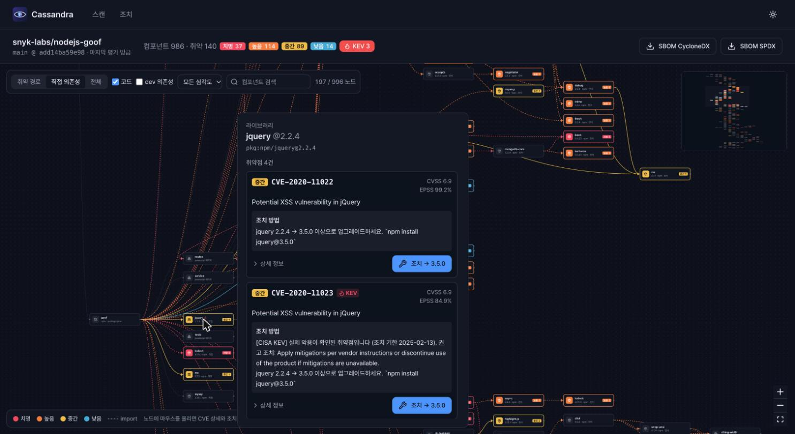
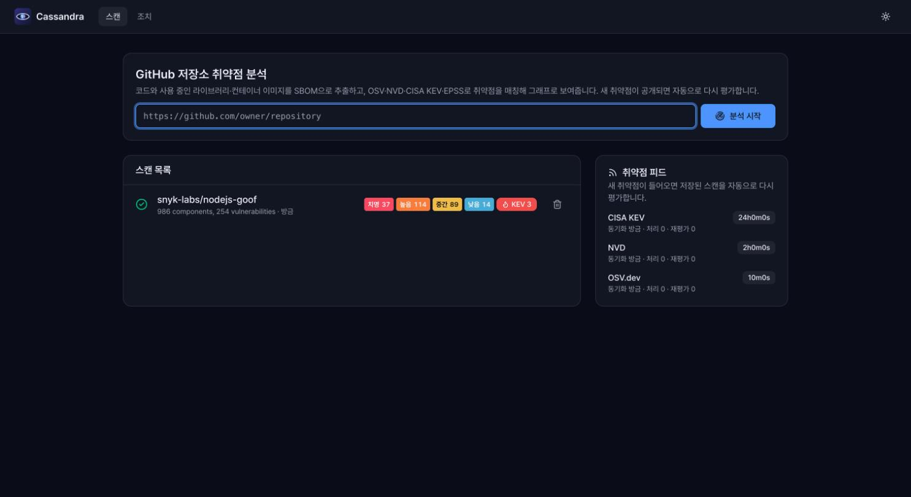
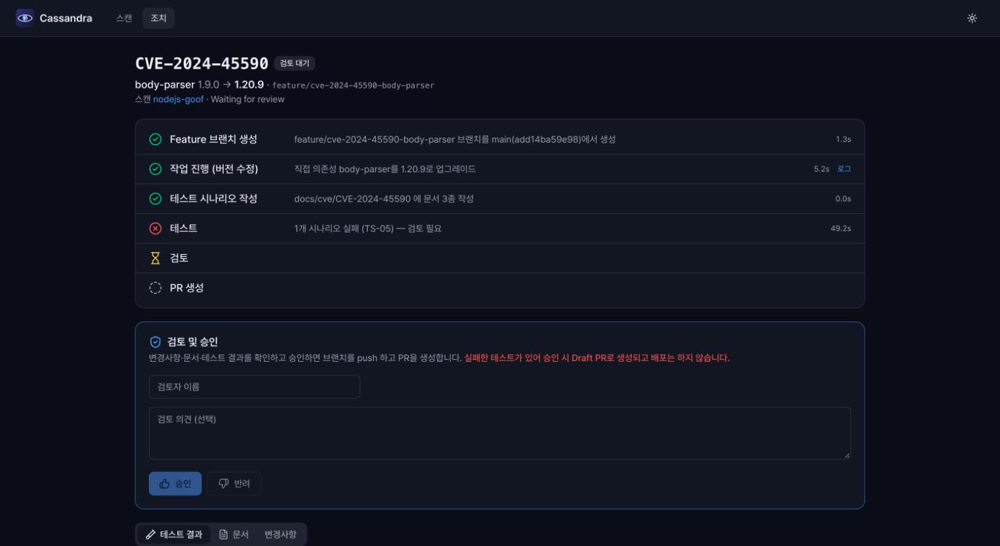
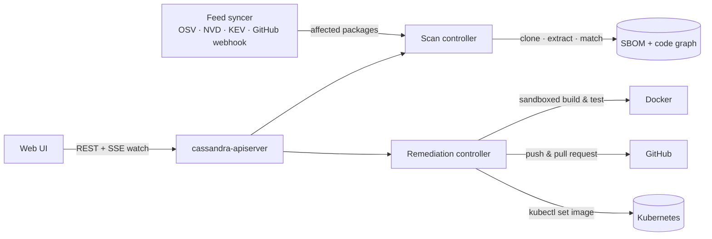

<div align="center">


# Cassandra

**See the vulnerabilities hiding in your code and its dependencies — and ship the fix as a reviewed pull request.**

[](backend/go.mod)
[](web/package.json)
[](#sbom)
[](#vulnerability-data)
[](LICENSE)

English | [한국어](README.ko.md)

</div>

<p align="center">
  
</p>

In Greek myth, Cassandra foresaw disaster before it arrived. Cassandra the tool does the same for software. Point it at a GitHub repository and it builds an SBOM, then draws your code, your libraries and your container images as one graph. It marks every component that has a known vulnerability. When a new advisory is published later, Cassandra re-evaluates the repositories you already scanned. To fix one, you hover over the node and click the fix button (**조치**). Cassandra then creates a branch, bumps the version, writes the test scenarios, runs them in a sandbox and waits for your approval before opening a pull request.

## Features

- **Code + dependency graph** — repository → manifests → source packages (import analysis for Go, JS/TS and Python) → direct and transitive libraries → container images → the server processes they run (nginx, httpd, …).
- **Vulnerability matching** — OSV for packages and NVD (CPE) for server processes, enriched with **CISA KEV** (known exploited) and **FIRST EPSS** (exploit probability). Aliases (GHSA / GO / PYSEC ↔ CVE) are collapsed into one finding.
- **Continuous re-evaluation** — incremental OSV, NVD and KEV syncs plus GitHub `security_advisory` webhooks re-match only the stored scans that contain an affected package. Changes reach the UI live over Server-Sent Events.
- **Hover to understand, click to fix** — every vulnerable node shows CVSS, EPSS, KEV due dates, the fixed version and an ecosystem-specific fix command.
- **Remediation pipeline** — branch → fix → test scenarios → sandboxed tests → review → approval → pull request. Server images additionally get image build → runtime test → deploy.
- **Generated documentation** — every fix commits `docs/cve/<CVE>/vulnerability-details.md`, `remediation.md` and `test-scenarios.md` (with results) to the branch.
- **SBOM first** — the SBOM is the source of truth of a scan. Download it as CycloneDX 1.6 (with vulnerabilities) or SPDX 2.3.
- **Kubernetes-style API** — `/apis/cassandra.io/v1alpha1` resources with list + watch, status subresources and controllers, modelled on kube-apiserver.

> [!NOTE]
> The web UI is currently in Korean. The API, CLI and generated SBOMs are language neutral.

## Screenshots

| Scans and live feed status | Remediation awaiting review |
|---|---|
|  |  |

## Quick start

**Prerequisites:** Go 1.27+, Node.js 24+, git and Docker (for sandboxed builds and tests).

```sh
git clone https://github.com/jinho-yoo-jack/Cassandra.git
cd Cassandra

# Needed to open pull requests and to scan private repositories.
export GITHUB_TOKEN=$(gh auth token)

make run   # builds the UI and the API server, then serves both on http://127.0.0.1:8080
```

Open http://127.0.0.1:8080, paste a repository URL such as `https://github.com/snyk-labs/nodejs-goof` and start the scan.

### Development

```sh
make dev-api   # API server on :8080
make dev-web   # Vite with hot reload on :5173, proxying /apis to :8080
make test      # go vet + go test -race + TypeScript type check
```

## How it works



1. **Scan.** The scan controller clones the repository and runs the manifest extractors to build the inventory (SBOM). It analyses source imports and matches every component against OSV and NVD.
2. **Watch.** The feed syncer follows upstream changes. Only scans that contain an affected package are re-evaluated, and new findings raise a `NewFindings` condition.
3. **Remediate.** The remediation controller is a state machine whose steps are recorded in `status.steps`. A restarted server resumes where it stopped.

### Remediation pipeline

| Kind | Steps |
|---|---|
| Library | Create branch → Apply fix → Write test scenarios → Test → **Review** → Pull request |
| Server image | Create branch → Bump image tag → Write test scenarios → Build image → Runtime test → **Review** → Deploy → Pull request |

Nothing is pushed before a human approves. If a test scenario fails, the remediation still goes to review, because the cause may be the project itself. Approving it then opens a **draft** pull request and skips deployment.

## Vulnerability data

| Source | Used for | Sync |
|---|---|---|
| [OSV.dev](https://osv.dev) | Package vulnerabilities (GHSA, Go, PyPA, RustSec, …) | `querybatch` per scan, `modified_id.csv` every 10 min |
| [NVD](https://nvd.nist.gov) | Server processes by CPE (nginx, httpd, tomcat, redis, …) | `lastModified` window every 2 h, rate limited |
| [CISA KEV](https://www.cisa.gov/known-exploited-vulnerabilities-catalog) | Known exploited vulnerabilities and due dates | daily |
| [FIRST EPSS](https://www.first.org/epss/) | Exploit prediction score | on demand, cached daily |
| GitHub `security_advisory` webhook | Push notification of new reviewed advisories | real time (optional) |

The research behind these choices is in [docs/research/vulnerability-feeds.md](docs/research/vulnerability-feeds.md) (Korean).

## Supported ecosystems

| Ecosystem | Manifests | Automatic fix |
|---|---|---|
| Go | `go.mod` (module graph resolved through the module proxy) | `go get` + `go mod tidy`; stdlib via `toolchain` |
| npm | `package-lock.json` v1–v3, `pnpm-lock.yaml`, `yarn.lock` | install / add; `overrides`, `pnpm.overrides`, `resolutions` for transitive deps |
| Python | `requirements*.txt`, `uv.lock`, `poetry.lock`, `Pipfile.lock` | requirements pin, `uv lock --upgrade-package` |
| Maven / Gradle | `pom.xml`, `build.gradle(.kts)`, `gradle.lockfile`, version catalogs | version literal, `${property}`, `dependencyManagement` |
| Rust | `Cargo.lock` | `cargo update --precise` |
| Ruby / PHP | `Gemfile.lock`, `composer.lock` | — |
| Containers | `Dockerfile`, Compose, Kubernetes manifests | `FROM` / `image:` tag bump (keeps suffixes such as `-alpine`), `ARG` defaults |

Cases without an automatic fix stop with a clear "manual remediation required" message.

## SBOM

```sh
curl -OJ 'http://127.0.0.1:8080/apis/cassandra.io/v1alpha1/scans/<scan>/sbom?format=cyclonedx'
curl -OJ 'http://127.0.0.1:8080/apis/cassandra.io/v1alpha1/scans/<scan>/sbom?format=spdx'
```

CycloneDX output includes the dependency graph and the matched vulnerabilities with ratings, fixed versions and remediation advice.

## API

Resources live under `/apis/cassandra.io/v1alpha1`. `GET /apis/cassandra.io/v1alpha1` returns the discovery document.

| Resource | Verbs |
|---|---|
| `scans` | create, get, list, watch, delete |
| `scans/{name}/graph`, `scans/{name}/sbom` | get |
| `remediations` | create, get, list, watch, delete |
| `remediations/{name}/approval` | create |
| `remediations/{name}/docs`, `remediations/{name}/diff` | get |
| `vulnerabilities/{id}` | get |
| `feeds` | get, list, watch |

```sh
# Start a scan and follow it live.
curl -X POST http://127.0.0.1:8080/apis/cassandra.io/v1alpha1/scans \
  -d '{"spec":{"repositoryURL":"https://github.com/owner/repo"}}'
curl -N -H 'Accept: text/event-stream' \
  'http://127.0.0.1:8080/apis/cassandra.io/v1alpha1/scans?watch=true'

# Approve a remediation.
curl -X POST http://127.0.0.1:8080/apis/cassandra.io/v1alpha1/remediations/<name>/approval \
  -d '{"approved":true,"reviewer":"alice","comment":"LGTM"}'
```

## Configuration

`cassandra-apiserver --help` lists every flag, grouped like kube-apiserver. The most common ones:

| Flag | Default | Description |
|---|---|---|
| `--bind-address` / `--port` | `127.0.0.1` / `8080` | Listen address. Keep it on loopback unless it sits behind authentication. |
| `--data-dir` | `~/.cassandra` | Database and working copies |
| `--github-token` | `$GITHUB_TOKEN` | Clone private repositories, push branches, open pull requests |
| `--github-webhook-secret` | `$GITHUB_WEBHOOK_SECRET` | Enables `POST /webhooks/github` for `security_advisory` events |
| `--nvd-api-key` | `$NVD_API_KEY` | Raises the NVD rate limit from 5 to 50 requests per 30 s |
| `--runner` | `docker` | `docker` (isolated) or `local` (no isolation) |
| `--toolchain-image` | `go=golang:1.27,node=node:24,…` | Override build images per toolchain |
| `--registry` | | Push remediated images here before deploying |
| `--static-dir` | | Serve the built web UI |

## Project layout

```
backend/
├── cmd/cassandra-apiserver/        # cobra command and grouped options
└── pkg/
    ├── apis/cassandra/v1alpha1/    # API types (TypeMeta / ObjectMeta / Spec / Status)
    ├── server/ · endpoints/        # generic API server, request info, REST handlers, SSE watch
    ├── registry/                   # REST storage per resource and subresource
    ├── storage/boltstore/          # generic Store[T] on bbolt with resourceVersion and watch
    ├── controller/                 # scan and remediation controllers (client-go workqueue)
    ├── feeds/                      # OSV / NVD / KEV syncers and the GitHub webhook
    ├── inventory/ · codegraph/     # manifest extractors and import analysis
    ├── vulndb/                     # OSV, NVD, KEV, EPSS clients, matching, CVSS
    ├── sbom/ · graph/              # CycloneDX / SPDX writers and the UI graph
    └── fixer/ · runner/ · deploy/  # automatic fixes, sandboxed execution, rollout
web/                                # React 19 · Vite · TanStack Router & Query · React Flow · Tailwind CSS
docs/                               # research, design notes, assets
```

Design decisions and the reasons behind them are recorded in [docs/design/architecture.md](docs/design/architecture.md) (Korean).

## Security

Cassandra builds other people's code and pushes branches, so it is careful by default:

- It listens on **loopback only** and has no built-in authentication. Put it behind an authenticating proxy before exposing it.
- Builds and tests run in **throwaway Docker containers**: as the host UID, with memory, CPU and PID limits, and with `no-new-privileges`. Running them on the host requires an explicit `--runner=local`.
- Dependency updates run with `--ignore-scripts`.
- GitHub credentials are injected through `GIT_CONFIG_*` environment variables scoped to `github.com`. They never appear in argv, remote URLs or `.git/config`.
- Webhook payloads are verified with `X-Hub-Signature-256`.

Please report security issues privately through [GitHub security advisories](https://github.com/jinho-yoo-jack/Cassandra/security/advisories/new) rather than public issues.

## Limitations

- Maven and Gradle builds are not executed, so only declared dependencies and committed lockfiles are seen.
- Container images are judged by their tag. OS packages inside images are not scanned yet. Floating tags (`latest`, `5`) are flagged as unpinned instead of being guessed.
- Single user, single process. There is no authentication or multi-tenancy.

## Contributing

Issues and pull requests are welcome. Before opening a pull request:

1. Run `make test`.
2. Use [Conventional Commits](https://www.conventionalcommits.org/) (`feat:`, `fix:`, `docs:`, `refactor:`, `test:`).
3. Keep backend code in the existing Kubernetes style: `Options → Config → Complete() → New()`, small interfaces, table-driven tests.

## License

Cassandra is licensed under the [Apache License 2.0](LICENSE).

## Acknowledgements

Vulnerability data from [OSV.dev](https://osv.dev), the [NIST National Vulnerability Database](https://nvd.nist.gov), the [CISA KEV catalog](https://www.cisa.gov/known-exploited-vulnerabilities-catalog) and [FIRST EPSS](https://www.first.org/epss/). The server architecture follows [Kubernetes](https://github.com/kubernetes/kubernetes) (`kube-apiserver`, `sample-apiserver`, `client-go`). Graphs are drawn with [React Flow](https://reactflow.dev) and [ELK](https://eclipse.dev/elk/), and SBOMs are written with [cyclonedx-go](https://github.com/CycloneDX/cyclonedx-go).
