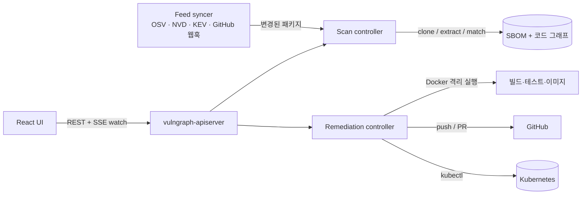

# VulnGraph

GitHub 저장소 하나를 넣으면 **코드와 사용 중인 라이브러리·컨테이너 이미지를 SBOM으로 추출해 그래프로 보여주고**, OSV·NVD·CISA KEV·EPSS로 취약점을 표시합니다. 노드에 마우스를 올리면 CVE 상세와 조치 방법이 나오고, **조치** 버튼으로 브랜치 생성 → 수정 → 테스트 시나리오 → 테스트 → 검토 → 승인 → PR 까지 진행합니다. Nginx·Apache 같은 서버 이미지는 이미지 재빌드 → 실행 테스트 → 배포까지 이어집니다.



## 빠른 시작

요구 사항: Go 1.27+, Node 24+, git, Docker(조치 단계의 격리 실행용).

```sh
# PR 생성과 비공개 저장소 접근에 사용 (없으면 PR 단계에서 멈춥니다)
export GITHUB_TOKEN=$(gh auth token)

make run          # UI + API → http://127.0.0.1:8080
```

개발 모드:

```sh
make dev-api      # API :8080
make dev-web      # Vite :5173 (/apis 를 :8080 으로 프록시)
make test         # go vet + go test -race + tsc
```

## 기능

| 요구사항 | 구현 |
|---|---|
| 실시간 취약점 수집 | [조사 문서](docs/research/vulnerability-feeds.md). OSV `modified_id.csv` 증분(10분), NVD `lastModified` 증분(2시간), CISA KEV(24시간), GitHub `security_advisory` 웹훅(push). 변경된 패키지를 가진 **저장된 스캔만** 다시 평가하고 SSE로 화면에 반영합니다. |
| 코드 + 라이브러리 그래프 | 저장소 → 프로젝트(매니페스트) → 코드 패키지(import 분석: Go·JS/TS·Python) → 라이브러리(직접·전이) → 이미지 → 프로세스. 보기 모드는 취약 경로 / 직접 의존성 / 전체 중에서 고를 수 있습니다. |
| CVE 표시 | 노드 테두리·뱃지에 심각도를 표시하고, KEV 등재 시 불꽃 아이콘을 붙입니다. 취약 노드로 이어지는 경로의 엣지는 강조합니다. |
| 마우스 오버 상세 + 조치 | CVSS·EPSS·KEV·수정 버전과 생태계별 조치 명령을 보여줍니다. 상세 정보(설명, CWE, 참고 링크)는 펼칠 때 불러오고, **조치** 버튼은 그 자리에 있습니다. |
| 조치 파이프라인 | 의존성: 브랜치 → 버전 수정 → 테스트 시나리오 → 테스트 → 검토 → 승인 → PR. 이미지: 브랜치 → 태그 수정 → 시나리오 → 이미지 빌드 → 실행 테스트 → 검토 → 승인 → 배포 → PR. |
| 문서 | `docs/cve/<CVE>/vulnerability-details.md`, `remediation.md`, `test-scenarios.md`를 작업 브랜치에 커밋합니다. |
| SBOM | 스캔 결과의 원본은 SBOM입니다. CycloneDX 1.6(취약점 포함)과 SPDX 2.3으로 다운로드할 수 있습니다. |

### 지원 매니페스트

Go(`go.mod` + 모듈 프록시로 실제 의존 그래프), npm(`package-lock.json` v1–3 · `pnpm-lock.yaml` · `yarn.lock`), Python(`requirements*.txt` · `uv.lock` · `poetry.lock` · `Pipfile.lock`), Java(`pom.xml` · Gradle 리터럴 · `gradle.lockfile` · 버전 카탈로그), Rust(`Cargo.lock`), Ruby(`Gemfile.lock`), PHP(`composer.lock`), 컨테이너(`Dockerfile` · compose · Kubernetes 매니페스트).

### 자동 수정 범위

| 생태계 | 방법 |
|---|---|
| Go | `go get mod@ver && go mod tidy`. stdlib 취약점은 `toolchain` 지시자를 올립니다. |
| npm / pnpm / yarn v1 | 직접 의존성은 install/add(정확한 버전 고정은 유지). 전이 의존성은 `overrides` / `pnpm.overrides` / `resolutions`. |
| Python | requirements 버전 고정, `uv lock --upgrade-package` |
| Maven | 리터럴·`${property}` 수정, 전이 의존성은 `dependencyManagement` |
| Gradle | 좌표 리터럴, 버전 카탈로그 |
| Cargo | `cargo update -p name@ver --precise` |
| 이미지 | `FROM`·compose·k8s 태그 교체(`-alpine` 같은 접미사 유지, 태그 존재 확인), `ARG` 기본값 |

그 밖의 경우(yarn berry, poetry, Pipfile, gradle.lockfile 재생성 등)는 "수동 조치 필요"로 표시하고 멈춥니다.

## 백엔드 구조 (kube-apiserver 패턴)

```
backend/
├── cmd/vulngraph-apiserver/app/          cobra 커맨드, Run
│   └── options/                          ServerRunOptions: 그룹별 flag set, Complete/Validate
├── pkg/apis/vulngraph/v1alpha1/          TypeMeta/ObjectMeta/Spec/Status 타입
├── pkg/server/                           GenericAPIServer: 필터 체인, healthz/readyz, PostStartHook, graceful shutdown
├── pkg/endpoints/                        RequestInfo 파싱 → verb별 rest 인터페이스 type assertion 디스패치, discovery, SSE watch
├── pkg/registry/{scan,remediation,...}/  REST storage + 서브리소스(graph, sbom, approval, docs, diff)
├── pkg/storage/boltstore/                제네릭 Store[T]: GuaranteedUpdate, 전역 resourceVersion, watch
├── pkg/apiserver/                        Config → Complete() → New() (sample-apiserver 방식)
├── pkg/controller/{scan,remediation}/    client-go workqueue 기반 컨트롤러
├── pkg/feeds/                            피드 동기화 + GitHub 웹훅
├── pkg/inventory/ + extractor/*          매니페스트 추출기(생태계별 패키지)
├── pkg/codegraph/                        import 분석
├── pkg/vulndb/{osv,nvd,kev,epss,cvss}/   매칭, 정규화, 조치 가이드
├── pkg/sbom/                             CycloneDX / SPDX
├── pkg/fixer/ · pkg/runner/              자동 수정 · 격리 실행
└── pkg/git/ · pkg/github/ · pkg/deploy/
```

API는 `/apis/vulngraph.io/v1alpha1` 에 있고, `GET /apis/vulngraph.io/v1alpha1` 이 discovery 문서입니다.

```sh
curl -X POST localhost:8080/apis/vulngraph.io/v1alpha1/scans \
  -d '{"spec":{"repositoryURL":"https://github.com/owner/repo"}}'
curl -N -H 'Accept: text/event-stream' 'localhost:8080/apis/vulngraph.io/v1alpha1/scans?watch=true'
curl -OJ 'localhost:8080/apis/vulngraph.io/v1alpha1/scans/<name>/sbom?format=cyclonedx'
curl -X POST localhost:8080/apis/vulngraph.io/v1alpha1/remediations/<name>/approval \
  -d '{"approved":true,"reviewer":"alice"}'
```

## 프론트엔드

React 19 · Vite 8 · TypeScript 7 · TanStack Router/Query · React Flow(@xyflow/react) + ELK · Tailwind CSS v4 + shadcn 스타일 컴포넌트(radix-ui) · Zustand · Zod · Sonner · react-markdown. 공급망 위험을 줄이려고 모든 버전을 정확히 고정했고, 배포된 지 2주가 지난 버전만 사용합니다(`npm install --before`).

## 보안 메모

- **기본 bind 주소는 `127.0.0.1`** 입니다. 이 서버는 다른 사람의 코드를 빌드하고 브랜치를 push 합니다. 외부에 노출하려면 인증 프록시 뒤에 두세요.
- 빌드와 테스트는 기본적으로 **Docker 격리 컨테이너**에서 실행합니다. 메모리·CPU·pids 를 제한하고, `no-new-privileges` 를 켜고, 호스트 UID로 실행합니다. `--runner=local` 은 명시적으로 지정해야 하며 격리가 없습니다.
- 의존성 수정 단계는 `--ignore-scripts` 로 설치 스크립트를 막습니다.
- GitHub 토큰은 `GIT_CONFIG_*` 환경변수로 github.com 에만 주입합니다. argv, 원격 URL, `.git/config` 에는 남지 않습니다.
- 웹훅은 `X-Hub-Signature-256` HMAC 서명을 검증합니다.
- 승인 전에는 아무것도 push 하지 않습니다. 테스트가 실패한 상태로 승인하면 Draft PR만 만들고 배포는 하지 않습니다.

## 한계

- Maven/Gradle 은 해석 도구를 실행하지 않으므로 선언된 의존성(과 커밋된 lockfile)만 봅니다.
- 컨테이너는 이미지 태그로 서버 프로세스 버전을 판정합니다. 이미지 내부 OS 패키지 스캔은 하지 않습니다. `latest`, `5` 같은 비고정 태그는 버전 판정 없이 "미고정"으로 표시합니다.
- OSV CSV 는 삭제 이벤트를 주지 않습니다. 철회(withdrawn)된 레코드는 재조회할 때 걸러집니다.
- 단일 프로세스·단일 사용자용입니다(인증·권한 없음).
