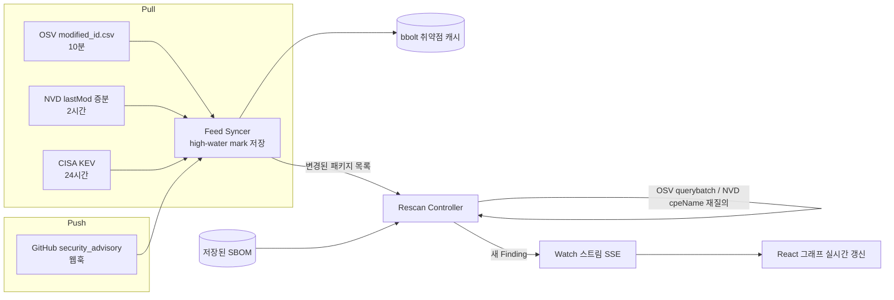

# 실시간 취약점 정보 수집 조사

> 조사일: 2026-11-22. 각 소스의 엔드포인트·제한은 공식 문서 기준이며, 공식 문서로 확인하지 못한 항목은 **(미확인)** 으로 표기했다.

## 1. 결론 요약

| 목적 | 1순위 소스 | 방식 | 이유 |
|---|---|---|---|
| 라이브러리(오픈소스 패키지) 매칭 | **OSV.dev** | Pull (API + 증분 CSV) | GHSA·Go vulndb·PyPA·RustSec·배포판 트래커를 하나의 스키마(OSV)로 정규화. 버전 범위 판정을 서버가 수행 |
| 프로세스/이미지(Nginx, Apache 등) 매칭 | **NVD API 2.0** (CPE) | Pull (2시간 증분) | 업스트림 바이너리는 패키지 생태계가 없어 CPE 로만 식별 가능 |
| 실제 악용 여부 | **CISA KEV** | Pull (일 1회) | "지금 공격받는 취약점" 목록. 우선순위 결정의 최상위 신호 |
| 악용 확률 | **FIRST EPSS** | Pull (조회 시점 + 캐시) | 30일 내 악용 확률. CVSS 만으로는 우선순위가 과대평가됨 |
| 즉시성 보강 | **GitHub `security_advisory` 웹훅** | **Push** | 리뷰된 GHSA 공개 시점에 바로 수신. 위 Pull 주기 사이의 공백을 메움 |
| 원천 데이터(CVE 레코드) | CVE Program `cvelistV5` | Pull (git) | 약 7분 주기 갱신. NVD 분석 지연과 무관하게 CVE 원본 확보 |

**설계 원칙:** "실시간"은 단일 소스로 달성되지 않는다. 대부분의 소스가 Pull 이므로, **증분 동기화(high-water mark) + 웹훅 Push + 저장된 SBOM 재평가**를 조합해 "새 취약점이 공개되면 이미 스캔한 레포의 그래프에 즉시 반영"되는 구조로 만든다.

## 2. 소스별 상세

### 2.1 OSV.dev (Google / OpenSSF)

- **질의 API**
  - `POST https://api.osv.dev/v1/querybatch` — 여러 `{package{name, ecosystem}, version}` 을 한 번에 질의. 결과는 입력 순서대로 `vulns[{id, modified}]` 만 반환(상세 없음). 철회(withdrawn)된 레코드는 결과에서 제외된다.
  - `GET https://api.osv.dev/v1/vulns/{id}` — 상세 레코드(affected 범위, fixed 버전, aliases, severity 벡터, references).
- **증분 동기화**
  - GCS 공개 버킷 `osv-vulnerabilities` 에 전체 덤프와 `modified_id.csv` 가 있다. 최상위 `modified_id.csv`(전 생태계)와 `<ECOSYSTEM>/modified_id.csv` 가 있으며 **최신순 정렬**이다.
  - 마지막으로 처리한 시각(high-water mark)보다 오래된 행이 나올 때까지만 읽으면 된다. 경계 누락을 막으려면 약간의 overlap 을 둔다.
  - CSV 는 **삭제 이벤트를 내보내지 않는다**. 삭제된 레코드는 주기적인 전체 스냅샷과 대조해 정리해야 한다.
- **장점:** 버전 범위 비교(semver, PEP 440, Maven 등)를 생태계별로 직접 구현할 필요가 없다. 서버가 판정한다.
- **식별자:** OSV ID 는 `GHSA-…`, `GO-…`, `PYSEC-…`, `RUSTSEC-…` 등 출처별로 다르다. CVE 는 `aliases` 에 들어 있으므로 **CVE 번호로 dedupe** 해야 한다.

### 2.2 NVD API 2.0 (NIST)

- `GET https://services.nvd.nist.gov/rest/json/cves/2.0`
  - 증분: `lastModStartDate` + `lastModEndDate` (둘 다 필수). NVD 권장은 **2시간 이상 간격**으로, 직전 수신 레코드 시각부터 현재까지 질의하는 것.
  - CPE 매칭: `cpeName=cpe:2.3:a:f5:nginx:1.25.3:*:*:*:*:*:*:*&isVulnerable` → 해당 버전이 취약한 CVE 만 반환.
- **Rate limit:** API 키가 없으면 30초당 5회, 있으면 30초당 50회. 키는 `apiKey` **헤더**로 보낸다. 초과 시 HTTP 429.
- **주의**
  - 2024~2025년 분석 적체(backlog)로 CVE 공개 후 CPE·CVSS 가 늦게 붙는 경우가 많았다. NVD 단독 의존은 위험하다.
  - 2025년 내부 처리 이슈로 NVD 가 `lastModStartDate` 를 `2025-02-26T00:00:00.000` 으로 재설정하라고 공지한 적이 있다. 동기화 상태를 리셋할 수 있게 설계해야 한다.
  - 날짜 범위 최대 120일 제한은 제3자 자료로만 확인했다 **(미확인)**. 구현에서는 범위를 120일 이하로 쪼갠다.
- **Nginx CPE 벤더 변경:** 오래된 CVE 는 `nginx:nginx`, 최근 CVE 는 `f5:nginx` 로 등록되어 있어 **둘 다 질의**해야 누락이 없다.

### 2.3 GitHub Advisory Database (GHSA)

- REST `GET /advisories` 와 GraphQL `securityAdvisories(updatedSince:)` 로 Pull 할 수 있다. 다만 리뷰된 GHSA 는 OSV 에 이미 수집되므로, 별도 Pull 은 중복이다.
- **Push:** GitHub App 에 `security_advisory` 웹훅을 구독하면 리뷰된 전역 advisory 가 게시·갱신될 때 이벤트를 받는다. 페이로드에는 `ghsa_id`, `cve_id`, `severity`, `vulnerabilities[].package`, `first_patched_version` 등이 들어 있다.
  - 이벤트의 정확한 구독 권한은 공식 문서로 확인하지 못했다 **(미확인)**.
  - 커뮤니티 토론(#67871)에 따르면 레포 단위 draft advisory 생성은 웹훅으로 받을 수 없다.
- 수신 서버는 `X-Hub-Signature-256` (HMAC-SHA256) 을 **반드시 검증**한다.

### 2.4 CISA KEV

- `https://www.cisa.gov/sites/default/files/feeds/known_exploited_vulnerabilities.json`
- 필드: `cveID`, `dateAdded`, `dueDate`, `requiredAction`, `knownRansomwareCampaignUse` 등.
- KEV 에 있으면 CVSS 와 무관하게 최우선 조치 대상으로 표시한다. `requiredAction` 은 조치 문서에 그대로 인용한다.

### 2.5 FIRST EPSS

- `GET https://api.first.org/data/v1/epss?cve=CVE-A,CVE-B,...` → `epss`(확률), `percentile`.
- 하루 1회 갱신되므로 하루 단위 캐시로 충분하다.

### 2.6 CVE Program `cvelistV5`

- GitHub `CVEProject/cvelistV5` 저장소는 CVE Services API 를 통해 **약 7분마다** 갱신된다. 릴리스 노트에 신규·갱신 건수가 기록된다.
- NVD 분석이 늦어도 CNA 가 작성한 원본(설명·affected·references)은 먼저 들어온다. "공개 직후 수 분 이내" 탐지가 필요하면 이 저장소를 `git fetch` 로 추적하는 것이 가장 빠르다.

### 2.7 기타 / 거버넌스 변화

- **EUVD (ENISA):** NIS2 근거로 운영되는 유럽 취약점 DB. ENISA 는 2025년 11월 CVE Root 가 되었다. 다만 제3자 분석(VulnCheck)에 따르면 EUVD 주 API 는 CVE.org·NVD 대비 누락이 많다고 한다. **보조 소스로만** 고려한다.
- **배포판 트래커(Debian, Alpine, Ubuntu, Red Hat):** 컨테이너 OS 패키지 취약점용. OSV 가 Debian·Alpine·Ubuntu 등을 이미 수집하므로, 이미지 내부 OS 패키지 스캔으로 확장할 때 OSV 로 일원화할 수 있다.

## 3. 이 프로젝트의 수집 아키텍처

1. **스캔 시점:** 레포 → SBOM(CycloneDX) 생성 → OSV `querybatch`(패키지) + NVD `cpeName`(프로세스/이미지)로 매칭 → KEV·EPSS 로 보강.
2. **스캔 이후(지속 감시):** Feed Syncer 가 각 소스의 증분을 가져온다. 변경된 취약점의 `affected` 패키지가 **저장된 SBOM 의 컴포넌트와 이름이 겹치면** 해당 스캔만 재질의한다. 버전 범위 판정은 다시 OSV/NVD 서버에 맡긴다.
3. **결과 전파:** 새 Finding 은 Scan 리소스 상태를 갱신하고, Watch(SSE) 로 열려 있는 화면에 즉시 반영된다.

### 동기화 상태(high-water mark) 규칙

- 소스별로 `lastSyncedAt` 과 `cursor` 를 저장한다. 실패 시 cursor 를 전진시키지 않는다(**at-least-once**).
- 같은 ID 의 레코드가 여러 번 들어오면 `modified` 가 더 최신인 것이 우선한다.
- 프로세스 재시작 후에는 저장된 cursor 부터 재개한다.

## 4. 리스크와 대응

| 리스크 | 대응 |
|---|---|
| NVD 분석 지연으로 CPE·CVSS 누락 | 패키지는 OSV 우선, CVSS 는 OSV severity 벡터 → NVD 순으로 폴백 |
| Rate limit (NVD 무키 30초당 5회) | 토큰 버킷 limiter + 응답 캐시. `--nvd-api-key` 옵션 제공 |
| ID 중복(GHSA ↔ CVE) | aliases 기준으로 CVE 를 대표 ID 로 사용. 문서 디렉터리도 `docs/cve/<CVE-ID>/` |
| 웹훅 위조 | HMAC-SHA256 서명 검증. 실패 시 401 |
| CSV 에 삭제 이벤트 없음 | `withdrawn` 필드 확인 + 주기적 전체 재검증 (향후 과제) |

## Sources

- [NVD — Start Here (API 키, rate limit)](https://nvd.nist.gov/developers/start-here)
- [NVD — API Workflows (증분 동기화 권장 방식)](https://nvd.nist.gov/developers/api-workflows)
- [NVD — API 2.0 Announcements (429 응답, lastModStartDate 리셋 공지)](https://nvd.nist.gov/general/news/api-20-announcements)
- [OSV — POST /v1/querybatch](https://google.github.io/osv.dev/post-v1-querybatch)
- [OSV — FAQ](https://google.github.io/osv.dev/faq)
- [Mirror and incrementally update the OSV database (modified_id.csv, 2026)](https://oneuptime.com/blog/post/2026-07-23-mirror-update-osv-database/markdown)
- [How OSV handles withdrawn/deleted records (2026)](https://oneuptime.com/blog/post/2026-07-23-osv-withdrawn-deleted-updated/markdown)
- [GitHub Community #67871 — draft advisory 웹훅 부재](https://github.com/orgs/community/discussions/67871)
- [GitHub Docs — Webhook events and payloads](https://docs.github.com/en/webhooks/webhook-events-and-payloads)
- [CVEProject/cvelistV5 README](https://raw.githubusercontent.com/CVEProject/cvelistV5/main/README.md)
- [ENISA — Stepping up our role: ENISA becomes CVE Root](https://enisa.europa.eu/news/stepping-up-our-role-in-vulnerability-management-enisa-becomes-cve-root)
- [CSA research note — ENISA CVE Root (2026-05)](https://labs.cloudsecurityalliance.org/wp-content/uploads/2026/05/CSA_research_note_enisa-cve-root-dual-governance_20260518-csa-styled.pdf)
